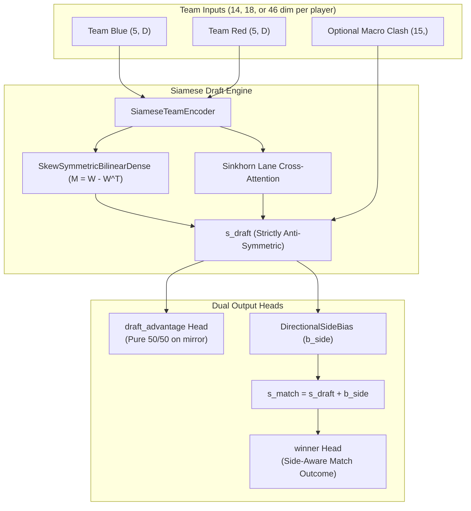

# NNriot

[](https://github.com/ktubi970/NNriot/actions/workflows/ci.yml)
[](https://github.com/ktubi970/NNriot/actions/workflows/playwright.yml)
[](https://www.python.org/)
[](LICENSE)
[](core/database.py)

**NNriot** is a League of Legends competitive match collection, analytical mining, and deep learning platform. It combines automated Riot API match and timeline collection into SQLite, equivariant and Siamese DeepSets neural networks for pre-match draft and outcome forecasting, an anti-symmetric draft combat engine decoupled from Summoner's Rift map bias, a selective classification decision layer (Chow's rule), and a Flask REST API with a React cockpit and existing Jinja pages.

> **Not included in this repository:** SQLite databases (`training_data.db`, `analytics.db`), model checkpoints (`*.keras`, `*.joblib`) and bulky generated run data (datasets, predictions, source snapshots) are excluded by `.gitignore`. A fresh clone can run the test suites, build the cockpit and start the web app, but predictions require a local checkpoint and its manifest, and collection requires your own Riot API key. Committed `runs/` folders keep only reports, metrics, protocols and split manifests.

## Project Status

**Served model (9 October 2026):** The fixed default is `runs/candidate_deepsets_v3/model.keras` (not distributed), a legacy 14D reference with unknown checkpoint-bound training dates, no calibration and no separate draft/side-bias heads. It is not validated for actionable serving; the service returns raw probabilities, explicitly null calibrated probabilities and abstention. Modern architecture capabilities below describe source code and experiments, not an automatic upgrade of saved checkpoints. See [the serving contract and reproducible common-cohort comparison](docs/model_serving/README.md), [the reference manifest](docs/model_serving/reference.manifest.json), [the actual comparable results](runs/served_model_comparison_20261009_complete/report.md) and [tests and verification](docs/model_serving/verification.md).

**Frontend (9 October 2026):** React/Vite, npm configuration and Playwright tooling have been restored to their original paths. Flask serves the redesigned, responsive cockpit at `/`, with the Jinja dashboard available at `/dashboard`. The interface starts with an empty draft, distinguishes raw and calibrated probabilities, shows conviction, threshold and abstention, and never substitutes demonstration predictions or player statistics when an API fails. Dialogs support keyboard navigation, focus restoration and reduced motion. The original source snapshot remains in [`archive/frontend-2026-10-09/`](archive/frontend-2026-10-09/ARCHIVE.md). Live/OCR imports are explicitly unavailable until backed by real endpoints.

---

## Key Capabilities

- **Equivariant & Siamese DeepSets Networks**: Permutation-invariant player pooling across team rosters (`TOP, JUNGLE, MIDDLE, BOTTOM, UTILITY`), Sinkhorn matchup cross-attention, and skew-symmetric bilinear forms.
- **Draft Combat Engine vs. Arena Bias Decoupling**: Pure composition counter-synergy ($s_{\text{draft}}$ via `draft_advantage`) is mathematically guaranteed to be strictly anti-symmetric ($s(A, B) = -s(B, A)$, yielding exactly 50/50 on mirror or balanced drafts). Empirical map bias ($b_{\text{side}}$ via `DirectionalSideBias`) is decoupled to reflect real-world match outcomes (the 52.5% value is an initialization prior for modern models, not a measured claim about this cohort or the legacy reference).
- **Multi-Scale Feature Spaces**:
  - **14-dim Base Priors**: Historical Bayesian player priors with explicit cold defaults, static champion profiles, and neutral legacy lane-matchup features under the served v1 contract.
  - **18-dim Early-Game Timeline Priors**: Objective gold differential (GD@15), CS differential (CSD@15), XP differential (XPD@15), and first blood involvement (FBI@10).
  - **46-dim Spatio-Temporal Trajectories**: Experimental recurrent embeddings of player positioning from a fixed, untrained GRU projection whose weights are committed in `core/assets/spatial_encoder_v1.json`; every stored embedding records its `encoder_id`. Serving and the common comparison still reject these candidates until embedding availability provenance is established.
- **Multi-Task Optimization with PCGrad**: Multi-objective training balancing primary heads (`winner`, `team_b_kill_lead`, `kill_handicap`) and auxiliary heads (`match_duration`, `first_blood_team`) by projecting conflicting gradients.
- **Selective Classification (Chow's Rule)**: Conviction-based decision framework with measured risk diagnostics providing conviction scoring $C = |P - 0.5|$, Wilson score confidence intervals, and three-tier actionability gating (`Tier 1: High Conviction`, `Tier 2: Leaning`, `Tier 3: Abstain`).
- **Prediction Facade**: Thread-safe `PredictionService` validating model manifests and feature compatibility, exposing raw/calibrated winner probabilities, and forcing abstention without calibration and independent validation. Legacy leave-one-player-out credits are diagnostic; the service does not silently activate ensemble weights.
- **Data Engineering & Analytics Mart**: Schema v16 SQLite database with WAL mode and transaction isolation, high-throughput Riot crawler, timeline backfilling, and a separate retrospective analytics evidence mart.

---

## Architectural & Mathematical Foundations

### 1. Invariance, Anti-Symmetry & Side Advantage Decoupling

Following the formal architecture conventions in [`AGENTS.md`](AGENTS.md):

1. **Anti-Symmetric Draft Evaluation ($s_{\text{draft}}$)**:
   The interaction between team compositions $T_A$ and $T_B$ satisfies strict anti-symmetry:
   $$s_{\text{draft}}(T_B, T_A) = -s_{\text{draft}}(T_A, T_B)$$
   For a mirror match ($T_A = T_B$), $s_{\text{draft}} = 0$, guaranteeing $P_{\text{draft}} = [0.50, 0.50]$ by construction via the dedicated `draft_advantage` head.
2. **Arena Side Advantage ($b_{\text{side}}$)**:
   On Summoner's Rift, the Blue side exhibits an empirical advantage (~51–53% winrate) due to camera perspective, baron/dragon pit geometry, and first-pick priority. This map bias is decoupled from composition analysis via a trainable additive layer:
   $$s_{\text{match}} = s_{\text{draft}} + b_{\text{side}}$$
   The `winner` head outputs the side-aware match outcome probability ($P(\text{Blue}) \approx 52.5\%$ on neutral drafts), while `draft_advantage` preserves pure draft analytics.
3. **Intra-Team Permutation Invariance**:
   Roster order within each team is canonicalized by role (`TOP, JUNGLE, MIDDLE, BOTTOM, UTILITY`) and pooled through symmetric DeepSets layers invariant to arbitrary player sequencing.



---

## Setup & Installation

### Requirements
- **Python**: Python 3.11+ (recommended: **Python 3.12**; CI runs 3.11 and 3.12)
- **Node.js**: Node 18+ and npm for React/Vite development and builds
- **Operating System**: Windows (native CPU) or Linux / Windows WSL2 (with NVIDIA GPU for accelerated training)

### 1. Environment Setup

From the repository root:

```powershell
# Create and activate virtual environment
python -m venv .venv312
.\.venv312\Scripts\Activate.ps1

# Install Python dependencies
python -m pip install --upgrade pip
pip install -r requirements.txt
pip install -r requirements-dev.txt

# Install frontend dependencies and build assets
npm ci
npm run build
```

### 2. Configuration (`.env`)

Copy `.env.example` to `.env` and set your credentials:

```bash
cp .env.example .env
```

Key environment variables:
- `RIOT_API_KEY`: Personal or production Riot Games API key (required for collection).
- `NNRIOT_DB_PATH`: Path to source SQLite database (defaults to `training_data.db`).
- `NNRIOT_ANALYTICS_DB_PATH`: Path to analytics database (defaults to `analytics.db`).
- `NNRIOT_CHECKPOINT_PATH`: Explicit checkpoint (default `runs/candidate_deepsets_v3/model.keras`; no automatic fallback).
- `NNRIOT_MODEL_MANIFEST_PATH`: Matching hashed manifest (default `docs/model_serving/reference.manifest.json` for v3).
- `HOST` and `PORT`: Web application host and port (defaults: `127.0.0.1:5000`).
- `NNRIOT_FETCH_TIMELINES`: Set to `1` to download match timelines during collection.

---

## Running NNriot

### Web Application

Start the web application with the configured database:

```powershell
# Production / Local Flask Server
python cli.py web

# With explicit database path
python cli.py web --db runs/active.db
```

Flask serves the React cockpit when `static/dist/index.html` exists. For frontend development, start Flask as above, then run Vite in a second terminal (API requests are proxied to port 5000):

```powershell
npm run dev
```

The launcher also supports `start.bat build`, `start.bat dev` and `start.bat test`. The default browser suite (`npm run test:e2e`) starts an isolated Vite server and mocks API responses; it does not start Flask, collection or training. It covers desktop, tablet and mobile with reduced motion. Use `npm run typecheck` for frontend types and `npm run test:unit` for the API adapter contract. The earlier cockpit tests remain available through `npm run test:e2e:legacy`; they include demonstration assertions, manual training and an old external screenshot path, so review them before opting in.

### Unified CLI Commands

```powershell
# 1. Train an evaluated pre-match candidate model
python cli.py train --samples 5000 --epochs 5 --batch-size 64 --feature-version v3_enriched --split-strategy chronological --calibrate

# 2. Benchmark statistical signal in draft features
python cli.py benchmark-signal --samples 10000 --feature-version v3_enriched

# 3. Continuous online training loop
python cli.py train-continuous

# 4. Backfill missing labels in database
python cli.py backfill
```

---

## Advanced Training & Pipelines

### Flagship Neural Pipelines

1. **DeepSets v4 with 18-dim Timeline Priors & PCGrad** (Experimental):
   ```powershell
   python scripts/train_deepsets_v4_timeline.py --db runs/active.db --epochs 10 --batch-size 64 --output-dir runs/candidate_deepsets_v4_timeline
   ```
   Trains on 18-dim timeline-augmented tensors (GD@15, CSD@15, XPD@15, FBI@10) and 15-dim macro clash features using projected conflicting gradients.

2. **DeepSets v3 (14-dim Base Priors)**:
   ```powershell
   python scripts/train_deepsets_v3.py --epochs 10 --batch-size 64 --output-dir runs/candidate_deepsets_v3
   ```

3. **Spatial Trajectory Embeddings (46-dim)**:
   ```powershell
   python scripts/compute_spatial_embeddings.py --db runs/active.db
   python scripts/train_spatial_deepsets.py --epochs 10 --batch-size 64
   ```
   Embeddings come from the pinned encoder only. The script refuses to append to a database that holds embeddings from other or unknown encoder weights (all rows written before schema v15); `--recompute-all` deletes and recomputes every stored embedding. Live collection skips embeddings in that case, and training reads only rows of the pinned `encoder_id`. Outputs are reproducible up to float round-off, which can vary with batch size and hardware.

4. **Tree Baselines & Ensembling**:
   ```powershell
   python scripts/train_tree_baseline.py --db runs/active.db --output-dir runs/tree_baseline
   python scripts/evaluate_ensemble.py --nn-model runs/candidate_deepsets_v4_timeline/model.keras --tree-model runs/tree_baseline/model.joblib
   ```

### GPU Training via WSL2

NVIDIA CUDA training is orchestrated through a dedicated WSL2 distribution (`NNriot-GPU`), keeping data in the Windows host while running TensorFlow with CUDA on Linux. See [`docs/gpu_training.md`](docs/gpu_training.md) for full instructions.

```powershell
# Verify GPU availability and matrix multiplication
.\scripts\train_gpu.ps1 -Check

# Train DeepSets v4 on GPU
.\scripts\train_gpu.ps1 -Script scripts/train_deepsets_v4_timeline.py -TrainingArgs @(
  '--output-dir', 'runs/candidate_deepsets_v4_gpu',
  '--epochs', '10',
  '--batch-size', '64'
)
```

### Match Collection & Timeline Extraction

```powershell
# High-throughput multi-region crawler
python scripts/crawler_1m.py

# Extract & backfill 15-minute timelines from Riot API
python scripts/backfill_timelines.py --db runs/active.db --duration-hours 4
```

---

## Data & Analytics

### SQLite Database (Schema v16)
- **WAL Mode**: Write-Ahead Logging enabled for concurrent reader performance.
- **Point-in-Time Bayesian Priors**: Streaming loader prevents lookahead data leakage by accumulating player history chronologically up to match time.
- **Participant Indexing**: Fast indexed queries over `match_participants` and compressed timeline blobs.
- **Database Merges**: Use `python scripts/merge_databases.py` to consolidate databases safely without duplicate rows or index corruption (see [`docs/database_merge.md`](docs/database_merge.md)). The merger accepts schema v16 inputs only (migrate a copy of older databases first); the target wins crawl-queue conflicts, source spatial embeddings are archived, never imported, match facts and their availability follow their match, and collection provenance (`anchor_selections`, `match_sightings`) is unioned.

### Retrospective Analytics Evidence Mart
The analytics mart extracts post-match associations, meta snapshots, and champion performance profiles into an isolated database:

```powershell
# Build analytics evidence mart
python -m analytics build

# Check analytics mart health
python -m analytics health
```
See [`docs/analytics.md`](docs/analytics.md) for details on query capabilities and limitations.

---

## Project Structure

```text
NNriot/
├── app/                  # Flask REST API, route handlers, and application factory
│   ├── routes/           # REST endpoints (api.py, explorer, spectator, monitor)
│   └── services/         # Application-level services
├── core/                 # Core domain logic, models, and data access
│   ├── collection/       # Crawler queue, ingestor, tracker, and Riot API service
│   ├── features/         # Strategy pattern feature extractors (static_meta, matchup, pipeline)
│   ├── deepsets_layers.py# DeepSets pooling, Siamese encoders, DirectionalSideBias
│   ├── equivariant_model.py# Anti-symmetric model architecture and custom layers
│   ├── pcgrad.py         # PCGrad multi-task gradient surgery
│   ├── selective_classification.py # Chow's rule, Wilson intervals, abstention logic
│   ├── selective_infer.py# Actionability tiers (Tier 1, Tier 2, Tier 3)
│   ├── prediction_service.py # Production PredictionService Facade
│   ├── database.py       # SQLite connection manager, schema v16 migrations
│   └── point_in_time_dataset.py # Leakage-free chronologically streaming dataset
├── frontend/             # Restored React/TypeScript cockpit and styles
├── e2e/                  # Restored Playwright browser tests
├── archive/
│   └── frontend-2026-10-09/ # Original source snapshot and restoration history
├── runs/                 # Experiment reports, metrics and split manifests (bulky data git-ignored)
├── scripts/              # Training, collection, benchmarking, and maintenance scripts
│   ├── train_deepsets_v4_timeline.py # Flagship 18-dim PCGrad training pipeline
│   ├── train_deepsets_v3.py          # 14-dim DeepSets training pipeline
│   ├── train_gpu.ps1                 # WSL2 CUDA training orchestrator
│   ├── backfill_timelines.py         # Timeline extraction and backfilling
│   ├── crawler_1m.py                 # Multi-region high-scale crawler
│   └── merge_databases.py            # SQLite database consolidation tool
├── analytics/            # Retrospective analytics mart engine and CLI
├── docs/                 # Architecture specifications, plans, and guides
│   ├── gpu_training.md               # Windows/WSL2 CUDA setup guide
│   ├── pre_match_training.md         # Pre-match validation and split protocol
│   ├── analytics.md                  # Analytics evidence mart documentation
│   └── database_merge.md             # Multi-database consolidation runbook
└── tests/                # Unit & integration tests; executed scope in docs/model_serving/verification.md
```

---

## Testing & Quality Assurance

NNriot enforces strict regression testing for all invariants, equivariance constraints, and pipeline changes.

```powershell
# Run the complete Python test suite
pytest tests/

# Run targeted Equivariance, Symmetry, and Layer tests
pytest tests/test_equivariant_model.py tests/test_deepsets_layers.py

# Run timeline features and PCGrad tests
pytest tests/test_train_deepsets_v4_timeline.py tests/test_pcgrad.py

# Run selective classification and inference tests
pytest tests/test_selective_classification.py tests/test_selective_infer.py

# Verify frontend types, API contracts and isolated browser behavior
npm run typecheck
npm run test:unit
npm run test:e2e
```

---

## Contributing & Security

See [.github/CONTRIBUTING.md](.github/CONTRIBUTING.md) and [.github/SECURITY.md](.github/SECURITY.md).

Licensed under [MIT](LICENSE).

## Legal

NNriot isn't endorsed by Riot Games and doesn't reflect the views or opinions of Riot Games or anyone officially involved in producing or managing Riot Games properties. Riot Games, and all associated properties are trademarks or registered trademarks of Riot Games, Inc.

Match data is collected through the [Riot Games API](https://developer.riotgames.com/) and is subject to the [Riot Developer Portal policies](https://developer.riotgames.com/policies/general). Use your own API key and never commit it.
