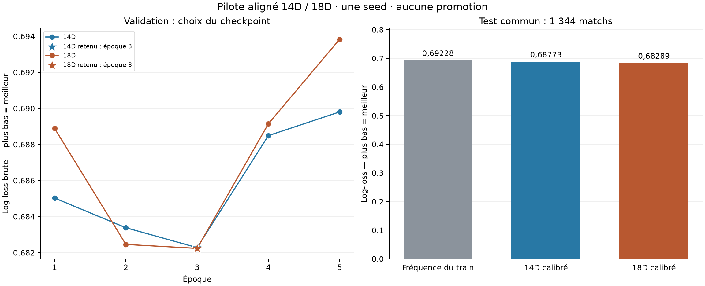

# Pilote aligné 14D / 18D — 11 octobre 2026

Le 18D obtient une log-loss calibrée plus faible que le 14D sur ce test. **Δ log-loss (18D − 14D) = -0,004840, IC exploratoire à 95 % [-0,008328 ; +0,000961].** L'intervalle exploratoire inclut zéro : ce pilote ne permet pas de départager clairement les deux modèles.

La collecte est restée arrêtée. Les deux nouveaux candidats restent des artefacts de recherche ; aucun remplacement du modèle servi n’a été effectué.

Le test de ce pilote est désormais évalué et ses matchs doivent rester protégés pour les expériences futures. Les mentions « reserved » dans les manifests immuables décrivent leur état avant cette évaluation ; le statut ultérieur est consigné dans `test_usage.json` et `comparison.json`.

**Scores sur le même test.** Log-loss et Brier : plus bas est meilleur ; AUC et exactitude : plus haut est meilleur. La baseline est une probabilité constante estimée sur les labels du train uniquement, P(équipe B) = 52,73 %.

| Candidat | Log-loss | Brier | AUC | Exactitude |
|---|---:|---:|---:|---:|
| Fréquence du train | 0,69228 | 0,24957 | 0,5000 | 52,16 % |
| 14D brut | 0,68876 | 0,24778 | 0,5585 | 54,84 % |
| 14D calibré | 0,68773 | 0,24729 | 0,5585 | 54,84 % |
| 18D brut | 0,68329 | 0,24520 | 0,5730 | 54,84 % |
| 18D calibré | 0,68289 | 0,24497 | 0,5730 | 54,84 % |

[Graphique vectoriel SVG](../../runs/aligned_comparison_20261011/pilot_comparison.svg).

**Cohorte et protocole.** Les deux dimensions utilisent les mêmes matchs et labels, après exclusions communes.

| Partition | Matchs | Première création | Dernière création |
|---|---:|---|---|
| Train | 44 184 | 15/05/2026 12:33 UTC | 16/09/2026 09:10 UTC |
| Validation | 3 000 | 16/09/2026 09:23 UTC | 16/09/2026 20:52 UTC |
| Test | 1 344 | 27/09/2026 10:30 UTC | 11/10/2026 10:22 UTC |

Le test utilise 1 344 matchs prospectifs disponibles, contre 3 000 initialement prévus : dérogation déclarée avant entraînement. La capture comporte 61 000 sources, dont 10 000 d’amorçage ; l’historique retient les 10 000 créations antérieures et uniquement les résultats terminés avant chaque cible. 87 cibles ont été purgées aux frontières temporelles. 14 cibles sans historique timeline ont été exclues des deux variantes. Les 5 000 anciens IDs de test sont protégés ; 2 000 étaient présents parmi les cibles de cette source.

Même builder actuel, macro de dimension 15, seed 42, 5 époques, batch 64, learning rate 0,0008, PCGrad ; arrêt anticipé désactivé. Le meilleur checkpoint et la température sont choisis sur la validation uniquement. Les checkpoints et calibrations ont été verrouillés avant les prédictions test ; aucun réglage n’a suivi leur lecture.

| Candidat | Époque retenue | Log-loss brute validation | Température |
|---|---:|---:|---:|
| 14D | 3 | 0,68228 | 1,1560 |
| 18D | 3 | 0,68224 | 1,2064 |

**Couverture sélective.** Tous les seuils fixés avant évaluation sont présentés, sans sélection du meilleur seuil. Les taux portent sur les probabilités calibrées ; les intervalles de Wilson sont descriptifs.

| Modèle | Conviction minimale | Retenus | Couverture | Exactitude retenue | Wilson 95 % |
|---|---:|---:|---:|---:|---|
| 14D | 0 % | 1 344 | 100,00 % | 54,84 % | [52,17 % ; 57,48 %] |
| 14D | 2 % | 1 071 | 79,69 % | 55,18 % | [52,19 % ; 58,14 %] |
| 14D | 4 % | 824 | 61,31 % | 57,52 % | [54,12 % ; 60,86 %] |
| 14D | 6 % | 585 | 43,53 % | 56,92 % | [52,88 % ; 60,88 %] |
| 14D | 8 % | 389 | 28,94 % | 57,07 % | [52,11 % ; 61,90 %] |
| 14D | 10 % | 227 | 16,89 % | 59,47 % | [52,98 % ; 65,65 %] |
| 14D | 12 % | 125 | 9,30 % | 58,40 % | [49,64 % ; 66,66 %] |
| 14D | 15 % | 40 | 2,98 % | 70,00 % | [54,57 % ; 81,93 %] |
| 18D | 0 % | 1 344 | 100,00 % | 54,84 % | [52,17 % ; 57,48 %] |
| 18D | 2 % | 1 039 | 77,31 % | 55,44 % | [52,40 % ; 58,43 %] |
| 18D | 4 % | 802 | 59,67 % | 56,61 % | [53,15 % ; 60,00 %] |
| 18D | 6 % | 554 | 41,22 % | 59,39 % | [55,25 % ; 63,40 %] |
| 18D | 8 % | 376 | 27,98 % | 62,23 % | [57,23 % ; 66,99 %] |
| 18D | 10 % | 230 | 17,11 % | 67,83 % | [61,54 % ; 73,53 %] |
| 18D | 12 % | 122 | 9,08 % | 72,95 % | [64,46 % ; 80,04 %] |
| 18D | 15 % | 40 | 2,98 % | 82,50 % | [68,05 % ; 91,25 %] |

**Vérifications.** 51 tests de partitions/parité/invariants/v4 passent, avec résultat JSON conservé. Le périmètre training/PCGrad a également donné 13 passes dans la sortie d’exécution de cette conversation (session 17243, chunk 0a8abd, exit 0) ; aucun log local indépendant n’a été conservé pour ce passage. Les 1 152 comparaisons de tenseurs sur 192 cibles constituent un replay échantillonné. La parité des 14 colonnes communes et des macros est exhaustive sur 48 528 cibles. Les hashes, memberships et purges sont vérifiés. Après entraînement, les deux modèles passent les invariants sur 64 cibles de validation : permutation, swap de draft, miroir neutre et biais de côté de la tête winner. L’erreur absolue maximale observée est 1.19e-07, pour une tolérance 1e-05. Les deux candidats ont produit 1 344 prédictions test chacun, avec 0 ligne exclue. La suite globale du dépôt n’a pas été relancée.

**Limites.** Une seule seed par candidat : l’intervalle n’inclut pas l’aléa d’entraînement. Le test commence 10,57 jours après la fin de la validation ; ce décalage de dates et les évolutions de population/patch peuvent affecter le transfert. Le bootstrap utilise 2 000 rééchantillonnages appariés, des blocs mobiles de 100 matchs chronologiques et la seed 20261011. Le test ne représente que 13,44 blocs non chevauchants équivalents : les intervalles restent exploratoires, et des joueurs communs ou dépendances temporelles peuvent traverser les blocs. Les résultats historiques sont supposés observables à la fin de partie, faute de dates d’ingestion. Les profils statiques de champions n’ont pas de provenance historique par patch. La validation a servi à sélectionner les checkpoints et à calibrer ; elle n’est pas un test indépendant. Les couvertures et intervalles descriptifs ne constituent pas une garantie de risque en service.

**Artefacts.** [comparaison complète](../../runs/aligned_comparison_20261011/comparison.json), [protocole](../../runs/aligned_comparison_20261011/protocol.json), [préparation et replay](../../runs/aligned_comparison_20261011/preparation_result.json), [état des entraînements](../../runs/aligned_comparison_20261011/training_status.json), [verrou des candidats](../../runs/aligned_comparison_20261011/lock.json), [test évalué et IDs à protéger](../../runs/aligned_comparison_20261011/test_usage.json), [tests invariants](../../runs/aligned_comparison_20261011/invariant_tests.json), [métriques 14D](../../runs/aligned_comparison_20261011/14d/model.metrics.json), [métriques 18D](../../runs/aligned_comparison_20261011/18d/model.metrics.json).
