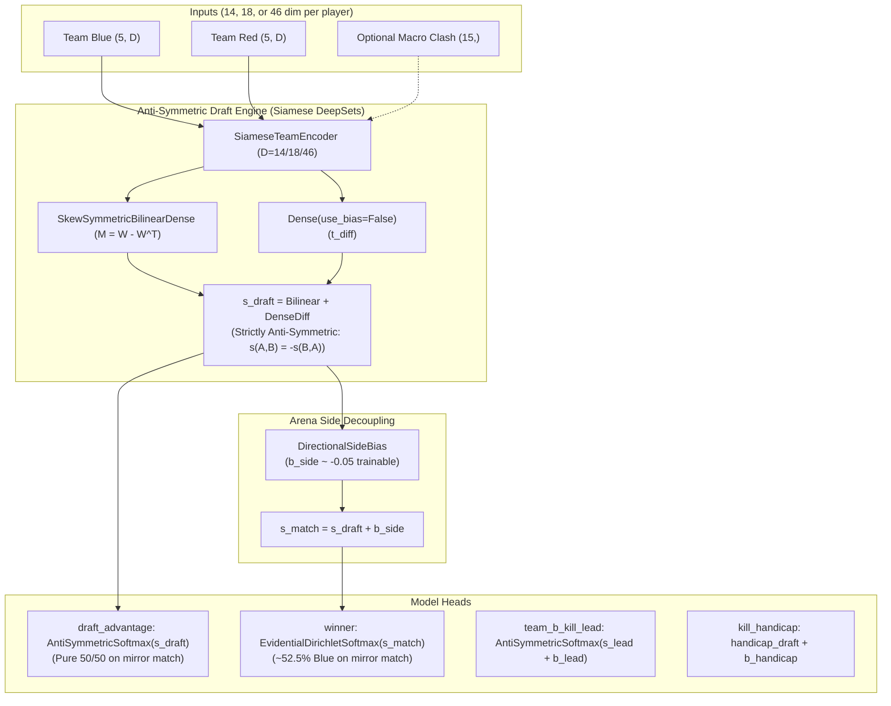

# Blue Side Advantage Architecture Implementation Plan (Adapted)

> **For agentic workers:** REQUIRED SUB-SKILL: Use superpowers:subagent-driven-development (recommended) or superpowers:executing-plans to implement this plan task-by-task. Steps use checkbox (`- [ ]`) syntax for tracking.

**Goal:** Decouple pure anti-symmetric draft combat from Summoner's Rift side advantage by introducing an explicit, trainable `DirectionalSideBias` layer on match prediction heads (`winner`, `team_b_kill_lead`, `kill_handicap`), while exposing both side-aware match probabilities and pure side-neutral draft advantages across all active tensor dimension profiles (14-dim base, 18-dim timeline v4, 46-dim spatial).

**Architecture:**
- **Draft Interaction $s_{\text{draft}}(T_{\text{blue}}, T_{\text{red}})$**: Remains strictly anti-symmetric ($s(A, B) = -s(B, A)$) via `SiameseTeamEncoder`, `SinkhornCrossAttention`, and `SkewSymmetricBilinearDense`. This holds across 14-dim base features, 18-dim timeline features, and 46-dim spatial features.
- **Arena Side Decoupling $b_{\text{side}}$**: An additive, trainable `DirectionalSideBias` layer shifts the match logit: $s_{\text{match}} = s_{\text{draft}} + b_{\text{side}}$ (initialized to $b_{\text{side}} \approx -0.05$, corresponding to ~52.5% Blue winrate prior on neutral drafts, where negative logit favors Team A / Blue).
- **Dual Head Output**: Exposes both the side-aware `winner` head (real-world match outcome) and a dedicated `draft_advantage` head (pure composition counter score).
- **Training Loop Harmony**: Fully backward-compatible with `scripts/train_deepsets_v4_timeline.py` (PCGrad multi-task with 18-dim timeline priors) and `scripts/train_spatial_deepsets.py` (46-dim spatial embeddings), logging side-bias convergence.
- **Service & Contract Alignment**: Updates `PredictionService` to report both `winner` (side-aware) and `draft_advantage` (side-neutral), and updates `AGENTS.md` §1 conventions.

**Tech Stack:** Python 3.12, TensorFlow 2.16+ / Keras 3, NumPy, SciPy, pytest.

---

## Global Constraints

- **Multi-dimension compatibility**: Must work seamlessly with 14-dim (`ENRICHED_PLAYER_TENSOR_DIM`), 18-dim (`ENRICHED_PLAYER_TIMELINE_TENSOR_DIM`), and 46-dim (`ENRICHED_PLAYER_SPATIAL_TENSOR_DIM`) player tensors.
- **Serialization safety**: Must register all custom layers (`DirectionalSideBias`) in `NNRIOT_CUSTOM_OBJECTS` and use `@tf.keras.utils.register_keras_serializable(package="nnriot")`.
- **Exact recovery**: When `enable_side_bias=False`, the model must reproduce exact mathematical anti-symmetry to machine precision ($P(A, B) = 1 - P(B, A)$ and $P(A, A) = 0.50$).
- **No training disruption**: The auxiliary `draft_advantage` head must NOT interfere with `LOSS_PER_HEAD` or `pcgrad_step` in `scripts/train_deepsets_v4_timeline.py`.
- **Permutation invariance**: Preserves DeepSets role invariance (`TOP, JUNGLE, MIDDLE, BOTTOM, UTILITY`) and macro clash anti-symmetry (`macro_ba = -macro_ab`).

---

## Codebase Context & Recent Changes Integrated

The codebase recently introduced:
1. **18-dim Timeline Player Priors** ([`core/features/pipeline.py`](file:///d:/projet/NNriot/core/features/pipeline.py)): GD@15, CSD@15, XPD@15, FBI@10.
2. **DeepSets v4 Training Pipeline** ([`scripts/train_deepsets_v4_timeline.py`](file:///d:/projet/NNriot/scripts/train_deepsets_v4_timeline.py)): multi-task PCGrad training on 18-dim tensors with 15-dim macro clash features.
3. **Spatial Trajectory Embeddings** ([`scripts/train_spatial_deepsets.py`](file:///d:/projet/NNriot/scripts/train_spatial_deepsets.py)): 46-dim player tensors.

This plan integrates directly with these modules without causing regressions.

---

## Proposed Changes



---

### Component 1: `DirectionalSideBias` Layer

#### [MODIFY] [`core/deepsets_layers.py`](file:///d:/projet/NNriot/core/deepsets_layers.py)
- Create and register `DirectionalSideBias`:
  - Additive scalar bias initialized to `initial_bias` (default `-0.05` for winner, where negative logit favors Blue / Team A).
  - Configurable trainability (`trainable=True`).
  - Serialisable via `@tf.keras.utils.register_keras_serializable(package="nnriot")`.

```python
@tf.keras.utils.register_keras_serializable(package="nnriot")
class DirectionalSideBias(tf.keras.layers.Layer):
    """Additive scalar bias representing arena side advantage (e.g. Summoner's Rift Blue side).

    Decouples:
    - Pure draft interaction f_draft(A, B) where f(A, B) == -f(B, A)
    - Real-world map asymmetry b_side where logit = f_draft + b_side
    """
    def __init__(
        self,
        initial_bias: float = 0.0,
        trainable: bool = True,
        **kwargs: Any,
    ) -> None:
        super().__init__(**kwargs)
        self.initial_bias = float(initial_bias)
        self.bias_trainable = bool(trainable)

    def build(self, input_shape: Any = None) -> None:
        self.bias = self.add_weight(
            name="side_bias",
            shape=(1,),
            initializer=tf.keras.initializers.Constant(self.initial_bias),
            trainable=self.bias_trainable,
        )
        super().build(input_shape)

    def call(self, inputs: tf.Tensor) -> tf.Tensor:
        return inputs + self.bias

    def get_config(self) -> dict[str, Any]:
        config = super().get_config()
        config.update({
            "initial_bias": self.initial_bias,
            "trainable": self.bias_trainable,
        })
        return config
```

---

### Component 2: Equivariant Multi-Task Architecture Update

#### [MODIFY] [`core/equivariant_model.py`](file:///d:/projet/NNriot/core/equivariant_model.py)
- Register `DirectionalSideBias` in `NNRIOT_CUSTOM_OBJECTS`.
- Update `build_equivariant_deepsets_model`:
  - Add parameters `enable_side_bias: bool = True` and `blue_win_prior: float = 0.525`.
  - Calculate initial side bias logit: `initial_winner_bias = 0.5 * np.log((1.0 - blue_win_prior) / blue_win_prior)` ($\approx -0.05$ for $52.5\%$).
  - Calculate pure anti-symmetric draft logit $s_{\text{winner, draft}}$.
  - If `enable_side_bias=True`:
    - Apply `DirectionalSideBias(initial_bias=initial_winner_bias, name="winner_side_bias")` to get $s_{\text{winner, match}}$.
    - Apply `DirectionalSideBias(initial_bias=-0.05, name="team_b_kill_lead_side_bias")` to `team_b_kill_lead`.
    - Apply `DirectionalSideBias(initial_bias=0.5, name="kill_handicap_side_bias")` to `kill_handicap` (+0.5 kills Blue advantage).
  - Expose `draft_advantage` head: `AntiSymmetricSoftmax(name="draft_advantage")(s_winner_draft)`.
  - Pass $s_{\text{winner, match}}$ (or $s_{\text{winner, draft}}$ if side bias disabled) to `EvidentialDirichletSoftmax` for the `winner` head.

---

### Component 3: Training Scripts & Monitoring

#### [MODIFY] [`scripts/train_deepsets_v4_timeline.py`](file:///d:/projet/NNriot/scripts/train_deepsets_v4_timeline.py)
- Monitor and log learned side bias after training epochs:
  ```python
  if model.get_layer("winner_side_bias", None) is not None:
      learned_b = float(model.get_layer("winner_side_bias").bias.numpy()[0])
      implied_blue_wr = 1.0 / (1.0 + np.exp(2.0 * learned_b))
      logger.info("Learned Blue side bias: b=%.4f (implied base Blue WR: %.2f%%)", learned_b, implied_blue_wr * 100)
  ```
- Retain unchanged loss compilation (`LOSS_PER_HEAD` handles the 7 supervised heads; `draft_advantage` is an unweighted auxiliary output).

---

### Component 4: Prediction Service & API Response Contract

#### [MODIFY] [`core/prediction_service.py`](file:///d:/projet/NNriot/core/prediction_service.py)
- In `PredictionService.predict_match()`:
  - Extract `draft_advantage` from model predictions if present:
    ```python
    raw_draft = preds.get("draft_advantage")
    if raw_draft is not None:
        p_draft_b = float(raw_draft[0, 1])
        p_draft_a = float(raw_draft[0, 0])
        favored = "team_a" if p_draft_a > p_draft_b + 0.01 else ("team_b" if p_draft_b > p_draft_a + 0.01 else "even")
        draft_adv_dict = {
            "team_a": round(p_draft_a, 4),
            "team_b": round(p_draft_b, 4),
            "favored": favored,
        }
    ```
  - Return `draft_advantage` in the returned payload alongside `winner`:
    ```json
    "winner": {
        "team_a": 0.5312,
        "team_b": 0.4688,
        "predicted": "team_a",
        "confidence": 0.5312
    },
    "draft_advantage": {
        "team_a": 0.5042,
        "team_b": 0.4958,
        "favored": "even"
    }
    ```

---

### Component 5: Architectural Convention Update

#### [MODIFY] [`AGENTS.md`](file:///d:/projet/NNriot/AGENTS.md)
- Update §1 ("Invariance et Anti-Symétrie Mathématique"):
  - Explicitly document the distinction between:
    1. **Anti-symétrie de Composition (Draft Invariant)**: Garanti par construction sur `draft_advantage` et dans les représentations latentes DeepSets siamois ($s_{\text{draft}}(B, A) = -s_{\text{draft}}(A, B)$).
    2. **Asymétrie de Terrain (Summoner's Rift Side Advantage)**: Capturé par `DirectionalSideBias` ($s_{\text{match}} = s_{\text{draft}} + b_{\text{side}}$), reflétant le winrate historique du Blue Side (~51-53%) sans biaiser l'évaluation intrinsèque de la composition.

---

### Component 6: Test Suite Hardening

#### [MODIFY] [`tests/test_equivariant_model.py`](file:///d:/projet/NNriot/tests/test_equivariant_model.py)
- Update existing tests:
  - Add test for `DirectionalSideBias` standalone layer (build, call, gradient, serialization).
  - Verify `enable_side_bias=False` reproduces exact machine-precision anti-symmetry for `winner`.
  - Verify `enable_side_bias=True` produces $P(\text{Blue wins}) > 0.50$ on mirror compositions ($T_A = T_B$).
  - Verify that for any composition $X$, playing on Blue produces a higher winrate than playing on Red:
    $P(\text{X wins} \mid X \text{ Blue}, Y \text{ Red}) > P(\text{X wins} \mid Y \text{ Blue}, X \text{ Red})$.
  - Verify that `draft_advantage` head remains strictly anti-symmetric even when `enable_side_bias=True`.
  - Verify multi-dimension compatibility: run with `player_feature_dim=14`, `player_feature_dim=18`, and `player_feature_dim=46`.

---

## Verification Plan

### Automated Tests
Run full suite in `.venv312`:
```powershell
.\.venv312\Scripts\python -m pytest tests/test_equivariant_model.py -v
.\.venv312\Scripts\python -m pytest tests/test_timeline_pipeline.py tests/test_train_deepsets_v4_timeline.py -v
.\.venv312\Scripts\python -m pytest tests/test_selective_classification.py tests/test_selective_infer.py -v
```

### Manual Verification
1. Inspect predictions on mirror compositions to confirm:
   - `draft_advantage`: `team_a: 0.5000, team_b: 0.5000` (neutral draft).
   - `winner`: `team_a: ~0.5250, team_b: ~0.4750` (Blue side advantage).
2. Confirm checkpoint save and restore with custom objects registry (`NNRIOT_CUSTOM_OBJECTS`).
