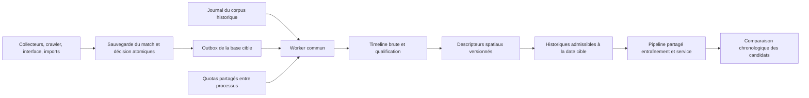

# Timelines universelles et historiques spatiaux — conception proposée

Date : 27 septembre 2026. Statut : proposition préparée à la demande « /plan it » ; aucune implémentation de ce nouveau périmètre lancée.

## Intention et résultat attendu

L'utilisateur veut maximiser la qualité de la prédiction **avant match**, en tenant compte des habitudes des joueurs et de leur complémentarité, y compris en soloQ. Il demande que les différentes méthodes d'ingestion intègrent les coordonnées. Les données restent sur D:.

Le résultat comporte deux livrables distincts :

1. Toute ingestion de match produit une décision durable de collecte de timeline. Un match admissible reste récupérable après panne, quelle que soit son entrée dans le système.
2. Les timelines des parties antérieures deviennent des caractéristiques spatiales versionnées. Leur intérêt prédictif est mesuré contre les mêmes modèles sans ces caractéristiques avant toute publication.

« Universel » concerne les **voies d'ingestion**, pas une garantie que Riot fournisse toutes les données. Le périmètre initial des téléchargements reste `queueId=420`, `mapId=11`, dix participants cohérents. Les autres queues reçoivent une décision explicite `out_of_scope`. Leur prise en charge nécessiterait une politique distincte ; on ne mélange pas discrètement normal, flex et soloQ.

## État constaté

- Les quatre parcours de `scripts/data_collector.py` et `scripts/background_collector.py` téléchargent les timelines seulement sous `NNRIOT_FETCH_TIMELINES=1`. Le drapeau est absent du `.env` inspecté et désactivé par défaut.
- `scripts/crawler_1m.py` et la synchronisation directe de `app/routes/history.py::api_player_history` ne les demandent pas.
- Les imports batch, Liquipedia, LoLPros et les autres routes de collecte délèguent aux collecteurs existants.
- Les collecteurs ignorent les matchs déjà enregistrés ; une timeline manquante ne bénéficie donc pas d'une reprise générale.
- Le stockage `match_timelines.timeline_json` conserve tout le JSON compressé, positions comprises. La fusion importe certaines timelines compatibles déjà présentes sans en télécharger.
- Le pipeline pré-match n'a aucune caractéristique spatiale historique. Les labels `first_to_N_kills` ne représentent pas des trajectoires et leurs têtes ont actuellement un poids de loss nul.
- La route `/api/predict/custom` reçoit des PUUID mais les retire de sa représentation synthétique et appelle encore directement un ancien trainer. Son passage effectif par `PredictionService`, avec conservation des identifiants, fait partie du raccordement requis.
- Le worktree `codex/timeline-collection`, à `3829d86` lors de la rédaction, contient le backfill robuste. La campagne et son journal sont sous `D:/projet/NNriot/runs/timeline_collection_20260927`. Le contrôle d'intégrité était encore en cours lors de cette rédaction.
- Un appel réel a fourni 24 frames, 240/240 positions valides, `frameInterval=60000` ms. Cette observation confirme un échantillonnage sur ce match, pas un suivi continu de tous les déplacements.

## Choix d'architecture

| Approche | Intérêt | Limite | Décision |
|---|---|---|---|
| Activer le drapeau et ajouter des appels dans chaque script | Modification courte | Oublis, doublons, échecs sans reprise, quotas concurrents | Écartée |
| Ajouter un journal séparé après chaque sauvegarde de match | Réutilisation proche du backfill | Deux commits : risque de match sans job après crash | Conservée uniquement pour le corpus historique figé |
| File transactionnelle dans la base des matchs, worker commun | Match et demande atomiques ; tous les producteurs couverts | Migration et adaptation de la fusion | Retenue pour l'ingestion continue |

Le schéma opérationnel passe de v12 à **v13**, lors d'une maintenance explicite sur une copie préparée. Une table `timeline_outbox` porte une ligne par match. Les fonctions centrales de sauvegarde ajoutent la décision dans la même transaction que le match ; elles ne contactent pas Riot.

Un moteur commun consomme soit l'outbox live, soit le journal historique par adaptateur. Le manifeste et la liste de candidats historiques restent immuables. Leur journal reste mutable pour les résultats et reprises. Les nouveaux matchs n'entrent jamais dans cet ancien manifeste.

## Contraintes communes

- Tous les fichiers de données, caches, bases temporaires, rapports et modèles candidats restent sous `D:/projet/NNriot/runs/` ; aucun cache de données sur C:.
- Chaque accès reçoit un `db_path` explicite et une identité de base vérifiée ; aucune écriture ne dépend du répertoire courant.
- Une timeline historique n'est admissible que si `history_end_ms < target_start_ms` ; une fin inconnue est exclue de l'historique prédictif.
- Les modèles respectent l'anti-symétrie sous échange d'équipes et l'invariance sous permutation intra-équipe ; les masques suivent les mêmes transformations.
- Aucun test ne contacte Riot ; les clés ne figurent ni dans les journaux, ni dans les bases de coordination, ni dans les rapports.
- La publication des bases suit `docs/database_merge.md` : sortie préparée, contrôle, arrêt des connexions, checkpoint WAL, copie de retour arrière et bascule explicite.
- La campagne actuelle et les modifications locales de l'utilisateur ne sont pas modifiées par cette planification.
- Aucun gain prédictif n'est affirmé sur la seule base d'un nombre de timelines collectées.

## A — Contrat d'ingestion

### Données et transactions

`timeline_outbox` contient : `match_id` PK/FK, `policy_version`, `candidate_json`, `state`, `reason`, `priority`, `attempts`, `not_found_checks`, `next_attempt_ms`, `last_http_status`, `last_error`, `lease_owner`, `lease_until_ms`, `created_at_ms`, `updated_at_ms`, `first_received_at_ms`, `quality_json`, `stored_bytes`. Index sur `(state,next_attempt_ms,priority,match_id)`.

États : `pending`, `leased`, `saved`, `retryable`, `not_found`, `invalid`, `unsupported`, `out_of_scope`. `saved` signifie reçu ; `quality_json.usable` porte l'exploitabilité. Une disponibilité partielle reste visible.

- Match et décision sont validés ou annulés ensemble. Réingérer un identifiant déjà présent vérifie également la décision à partir du **match canonique enregistré**, sans modifier sa priorité de données.
- Réserver un job est une transaction courte ; la requête réseau est hors transaction ; écrire le brut et terminer le job live est une deuxième transaction atomique.
- Réservation de 300 secondes, un propriétaire et un renouvellement avant expiration lors d'attentes longues de quota. Une réservation expirée est réconciliée. Un résultat reçu par un ancien propriétaire ne peut pas écraser celui du propriétaire courant.
- Ancien NULL : téléchargeable. Payload valide : conservé. Payload non NULL corrompu : `invalid`, réparation explicite avec archive du brut précédent ; jamais d'écrasement silencieux.
- Conserver les délais du backfill : 404 revérifié après 24 heures, trois contrôles maximum ; erreur transitoire réessayable après au moins cinq minutes et le délai serveur, cinq passages maximum. Un épuisement reste visible, sans devenir « indisponibilité permanente ».
- Un 401/403 arrête proprement le consommateur et conserve la demande. Chaque tentative HTTP, y compris celle qui déclenche l'arrêt auth, figure dans le rapport.
- Distinguer `queue_drained` et `all_eligible_saved`. Une file sans travail dû contenant des erreurs terminales n'est pas déclarée intégralement collectée.

Une métadonnée `database_identity` identifie la base. Une sortie de migration/fusion publiée reçoit une nouvelle identité ; le processus doit annoncer celle attendue. La copie de retour arrière garde son identité et ne peut être consommée simultanément comme base active.

### Quotas et activation

Tous les appels des deux chemins HTTP Riot utilisent un coordinateur SQLite commun sur D:, y compris détails de match, identités et timelines. Il réserve avant chaque tentative, sans conserver la transaction durant l'attente ou le réseau. Il sépare limites application et méthode/hôte, respecte les en-têtes observés, et applique un cooldown partagé à chaque 429, même au dernier essai.

Par défaut, garder le plafond conservateur actuel de 18 appels/seconde et 95/120 secondes, globalement pour la clé, en plus des limites plus restrictives observées. Utiliser une empreinte opaque de clé sans stocker la clé. Si le coordinateur est indisponible, suspendre les appels ; aucun repli silencieux sur un limiteur local. Les sauts d'horloge doivent conduire à une attente conservatrice, jamais à une rafale.

Remplacer l'opt-in de téléchargement dans les producteurs par une décision systématique. Le worker se lance explicitement avec sa base et ses limites ; une absence de worker crée une file en attente, pas une perte de demandes. Les imports/fusions ne lancent pas de réseau.

### Bascule opérationnelle

Développer dans un checkout séparé du worktree utilisé par le processus actuel. Réutiliser les commits existants sans modifier le code sous son processus. Préparer les bases v13 sur D:, puis effectuer un handoff à une frontière de lot : arrêt propre des anciens processus, vérification des journaux, adoption du coordinateur partagé, reprise des mêmes fichiers historiques et démarrage du worker live. Ne pas exécuter simultanément un ancien collecteur non coordonné et les nouveaux workers avec la même clé.

## B — Contrat spatial v1

### Ce que les données permettent

Le v1 décrit les positions **observées**, les zones fréquentées et la proximité d'autres joueurs. Il ne prétend pas reconstruire la trajectoire exacte, la vitesse instantanée, les ganks ou les intentions. Aucune interpolation n'est enregistrée comme observation. Les événements restent disponibles dans le brut mais ne sont pas mélangés aux frames pour calculer l'occupation : cela surpondérerait les endroits où surviennent des événements.

Le cache dérivé, séparé de la base opérationnelle, est indexé par `(match_id,puuid,spatial_schema,raw_sha256)`. Il conserve `start_ms`, `end_ms`, rôle, champion, côté physique, valeurs, masques et dénominateurs. Le hash est celui du JSON canonique décompressé, pour éviter qu'une date d'en-tête gzip change artificiellement la provenance.

Le cache et la file enregistrent aussi `first_received_at_ms` et `extracted_at_ms`. Le benchmark historique principal est rétrospectif : il mesure le signal avec les archives des matchs déjà terminés, et ne prétend pas que ces archives avaient effectivement été téléchargées à cette époque. Un contrôle prospectif conserve séparément la disponibilité réelle à l'instant de prédiction ; aucune date de réception ancienne n'est inventée pour un backfill.

### Paramètres proposés et figés pour le premier benchmark

- Schéma : `spatial_v1`. Phases relatives en minutes : `[2,10)`, `[10,20)`, `[20,30)`. Les phases non atteintes restent manquantes.
- Coordonnées numériques : `u=x/15000`, `v=y/15000`. **15000 est une échelle de normalisation choisie**, pas une affirmation de frontière physique exacte. Conserver les valeurs hors `[0,1]` et les compter dans une case extérieure.
- Vue du joueur : équipe physique 100, `(u,v)` ; équipe physique 200, `(1-u,1-v)`. Le côté provient du match brut. Échanger les noms A/B dans une prédiction ne modifie pas le côté physique des historiques.
- Par phase : 10 fréquences de cases (grille 3×3 et case extérieure), deux moyennes, deux variances de coordonnées, deux distances moyennes au plus proche allié/adversaire, deux fréquences de proximité à moins de 2000 unités. Soit **18 valeurs par phase, 54 au total**.
- Chaque mesure possède son dénominateur. Proximité alliée/adverse : seulement les frames avec les positions nécessaires. Au moins trois observations valides par mesure et phase pour activer son masque. `(0,0)` reste une observation finie ; aucune exclusion fondée uniquement sur cette valeur.
- Doublon exact de timestamp/participant : dédupliqué et compté. Doublon contradictoire : observation invalidée et signalée. L'extraction est déterministe, quel que soit l'ordre du JSON.
- Les fréquences portent sur les observations, pas une durée interpolée. Les trous et cadences inhabituelles figurent dans la qualité ; ne pas convertir automatiquement 10 observations en 10 minutes.

Pour un joueur à la date cible, prendre au plus ses **20 derniers historiques de même rôle**, terminés avant cette date, toutes sélections de champion confondues. Poids de récence à demi-vie de 30 jours ; lissage de force 5 vers un prior de rôle construit uniquement avec les historiques déjà disponibles. Rôle inconnu : groupe `UNKNOWN` explicite. Aucune fusion automatique de comptes supposés appartenir à une même personne.

Profil : 54 valeurs, 54 masques, six métadonnées (`log1p(history_count)`, trois `log1p(observation_count_phase)`, âge du dernier historique, couverture moyenne). Soit **114 dimensions**, appelées `STYLE_DIM`. Une mesure absente est zéro avec masque nul ; la valeur zéro seule ne signifie pas « pas d'historique ». Le normaliseur est appris sur train seulement et sérialisé.

Complémentarité v1 : pour chaque phase, moyenne et dispersion des chevauchements des distributions de cases entre les dix paires non ordonnées d'une équipe, seulement sur les paires valides. Une troisième valeur indique leur couverture. Soit **9 valeurs par équipe**. C'est une compatibilité de profils individuels, pas une preuve de synergie de duo. L'historique de duos est hors périmètre initial.

### Temps, modèles et service

Un flux de fins de parties met à jour les historiques avant chaque cible, seulement pour les fins strictement antérieures. La règle s'applique aussi aux priors agrégés de la baseline ; son implémentation actuelle par ordre de début doit être rapprochée de cette exigence avant comparaison.

Le split utilise le vrai début connu du match. Les cibles d'entraînement dont la fin franchit la frontière suivante sont purgées. Le scaler, les poids, la calibration et les seuils ne sont jamais réajustés sur test.

Deux protocoles sont rapportés séparément : `frozen`, historique figé à la fin de train pour validation/test ; `replay`, enrichissement par les matchs d'évaluation déjà terminés, sans réentraînement. Le protocole primaire de promotion est `replay`, correspondant à l'usage prévu avant match ; `frozen` sert de contrôle. Tous les candidats suivent exactement les mêmes règles et matchs cibles.

Introduire `feature_version=spatial_v1` sans modifier silencieusement les 14 dimensions historiques. Candidat neuronal : tensors `(5,128)` par équipe, soit `14+114`, plus les 9 valeurs de complémentarité par équipe dans une branche partagée optionnelle. Le score final reste une différence de scores d'équipes avec tête anti-symétrique. Les modèles arbres utilisent le même ordre de rôles et une symétrisation explicite.

`PredictionService` est le seul orchestrateur d'inférence. Un identifiant joueur absent donne un profil manquant, jamais un profil déduit du seul pseudo. Il reçoit une date cible explicite et le store historique ; aucun endpoint ne calcule ces caractéristiques. Les artefacts annoncent schéma, dimensions, protocole temporel, normaliseur, fenêtres, hash du corpus et calibration. Un modèle ancien garde son ancien chemin ; une version incompatible produit une erreur explicite. Les réponses gardent probabilités calibrées, conviction, tier et abstention, et ajoutent la couverture historique réellement utilisée.

### Évaluation et critères de promotion proposés

Comparer à budget de réglage égal, sur les mêmes matchs et graines : `baseline`, `styles`, `styles+complementarity`, pour arbre puis réseau siamois. Ajouter un contrôle `coverage_only` afin de distinguer contenu spatial et simple disponibilité d'historique. Ne pas modifier les poids des têtes auxiliaires à cette occasion.

Geler le protocole dans un manifeste avant entraînement : découpe temporelle 70/15/15, frontières et IDs, purge des chevauchements, trois graines 17/29/43, budget identique de six configurations par variante/famille choisies sur validation. Calibration par température sur la partie chronologiquement finale de validation ; la partie initiale sert à la sélection, sans chevauchement de labels aux frontières.

Pour contrôler la capacité, les variantes expérimentales NN partagent les mêmes formes 128+9 ; les blocs absents sont mis à zéro. La référence legacy est rapportée séparément. Le candidat par configuration est la moyenne arithmétique des probabilités des trois graines, avant calibration ; aucune graine n'est choisie sur test. Les paramètres exacts, le coût et la latence de cet ensemble sont enregistrés.

Budget maximal initial : 2 familles × 4 variantes × 6 configurations × 3 graines = **144 entraînements**, hors référence legacy. La sélection et l'early stopping utilisent le protocole replay. Le contrôle frozen réutilise ces mêmes modèles et ne double pas l'entraînement. Mesurer temps et mémoire lors du smoke test avant d'engager ce budget ; toute réduction doit garder des budgets comparables et être inscrite avant lecture du test final.

Avant le benchmark, publier les profondeurs 1/5/10/20 par joueur, la couverture des dix joueurs, les proportions par date/patch/région et les erreurs. Ne pas supprimer les cibles sans historique. Un test de moins de 5000 matchs ou de dix jours UTC distincts produit un résultat exploratoire, sans promotion.

Seuils de promotion du candidat sélectionné, préenregistrés : réduction de log-loss moyenne d'au moins **0,002**, borne basse de l'IC 95 % du gain strictement positive ; borne haute de dégradation du Brier ≤ **0,002** ; augmentation ponctuelle d'ECE à 15 bins ≤ **0,01** ; borne basse du delta d'accuracy ≥ **−0,005**. Bootstrap apparié par blocs de jour UTC, 2000 réplications, avec contrôle secondaire par blocs de sept jours lorsque la durée le permet. Rapporter l'incertitude et la sensibilité à la dépendance entre matchs de mêmes joueurs ; un bootstrap ne garantit pas à lui seul la généralisation.

Les marges sont des choix de conception proposés avant les résultats, pas des garanties de significativité pour le corpus disponible. Si les critères échouent ou restent indécidables, conserver la baseline. Le test final est consulté une seule fois pour le candidat choisi ; des ajustements ultérieurs exigent un nouveau bloc futur intact.

## Plans et limites de portée

- [Plan A — ingestion universelle](../plans/2026-09-27-universal-timeline-ingestion.md) : livrable autonome et utile même si les caractéristiques spatiales n'apportent aucun gain.
- [Plan B — profils spatiaux et prédiction](../plans/2026-09-27-spatial-history-prediction.md) : contrats, cache, historiques, modèles, service et benchmark.

Ne sont pas inclus : collecte d'autres jeux ou queues, reconstruction vidéo, extension automatique de l'historique par appels supplémentaires aux joueurs, modèle de trajectoire profond, détection causale d'intention, promotion automatique en production. Une architecture séquentielle apprise pourra être comparée dans une expérience séparée si le corpus et les premières ablations justifient son coût ; le v1 ne prétend pas être l'optimum absolu.
